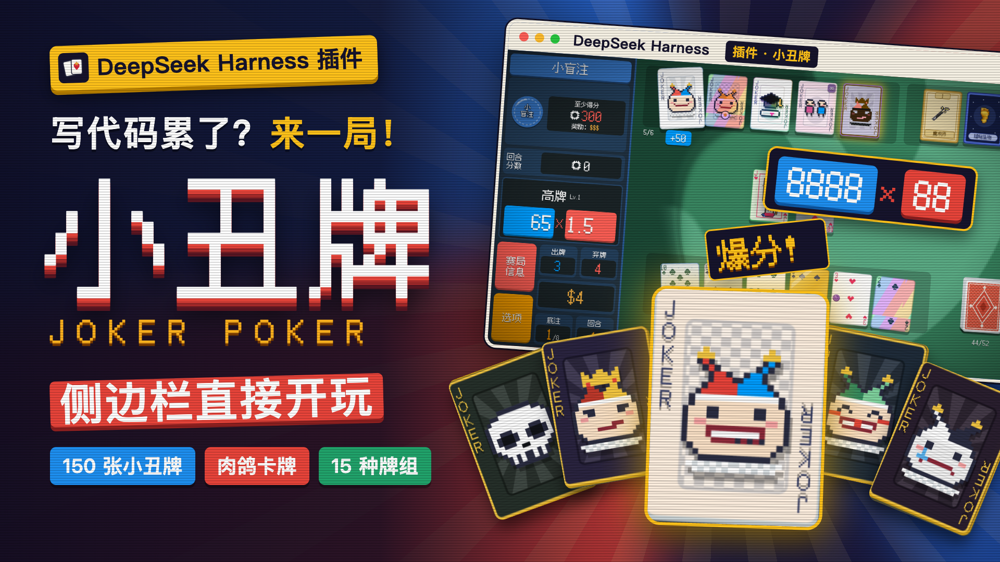
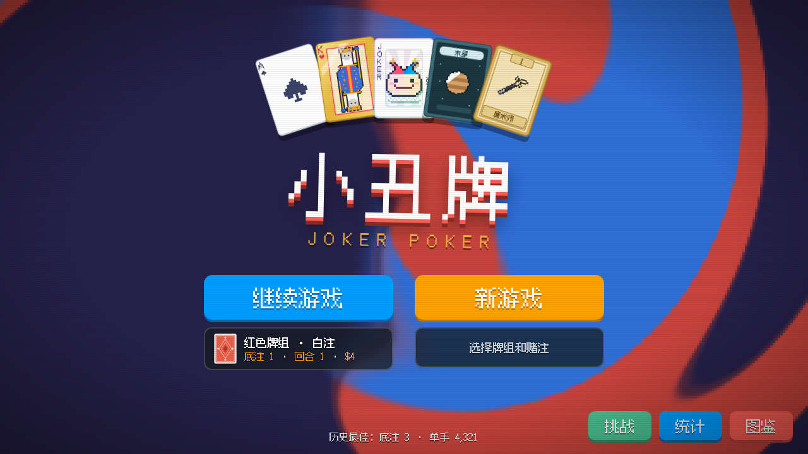
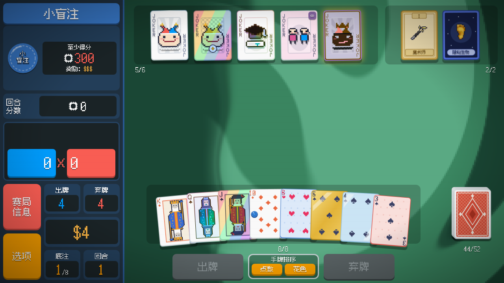
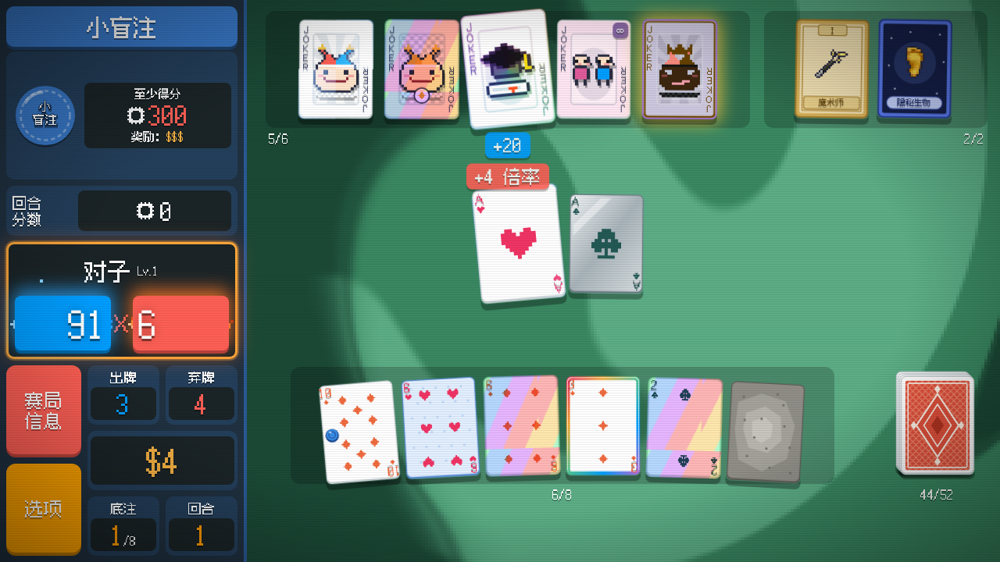
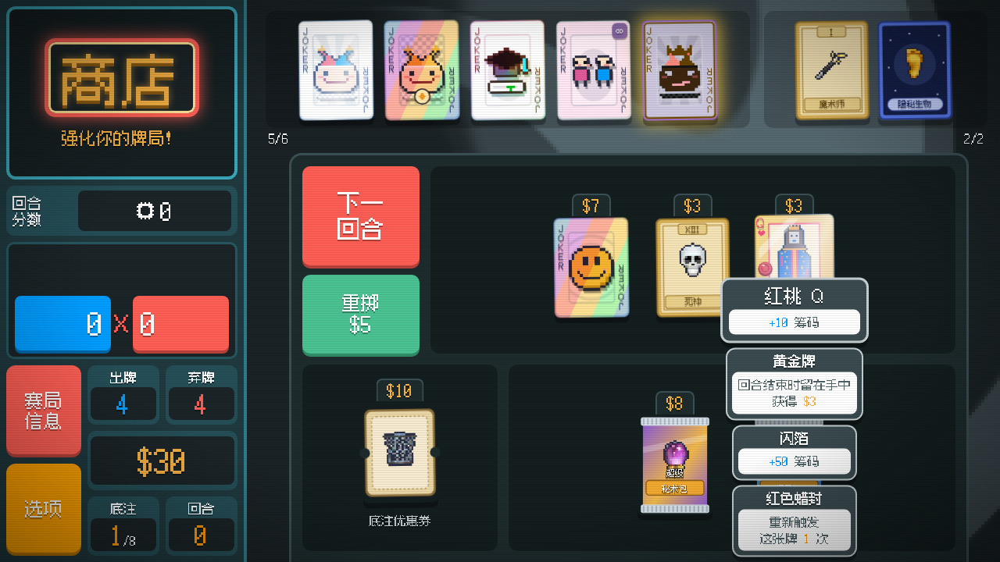
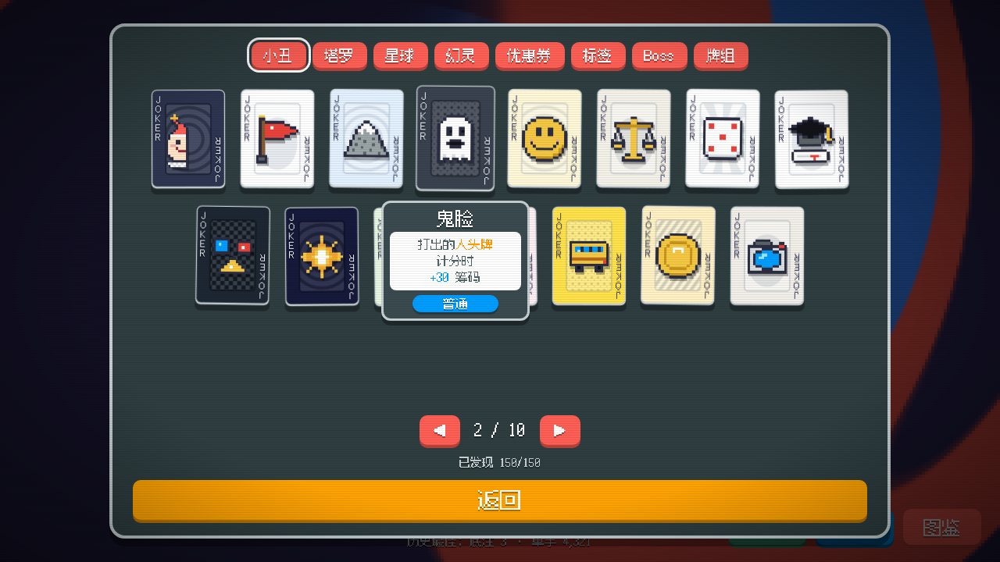
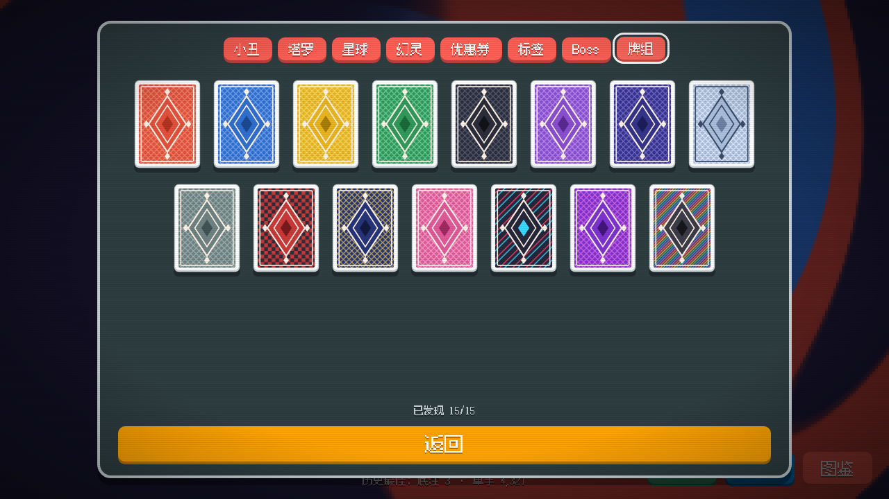

# 小丑牌 · Joker Poker

运行在 **DeepSeek Harness** 侧边栏中的扑克牌 Roguelike 游戏插件。通过打出牌型、收集小丑牌、购买升级和调整牌组，在有限的出牌次数内达到盲注目标。

当前版本：`0.17.0`。本项目受 Balatro 玩法启发，是独立的非官方项目，与原作及其开发者无隶属关系。



## 游戏截图

标题界面与对局：选择牌组，开始构筑。

| 标题界面 | 游戏对局 |
| --- | --- |
|  |  |

逐步计分与商店：叠加小丑牌效果，购买升级。

| 计分过程 | 商店 |
| --- | --- |
|  |  |

收藏图鉴：150 张小丑牌与 15 种牌组。

| 小丑牌图鉴 | 牌组图鉴 |
| --- | --- |
|  |  |

点击图片可查看大图。以上为游戏界面演示截图。

## 功能

- **150 张小丑牌**：独立效果与组合机制，配有代码绘制的像素图案。
- **15 种牌组、8 个赌注等级、20 个挑战**，支持解锁进度与收藏查看。
- 牌型计分、筹码与倍率、小盲注／大盲注／Boss 盲注、商店与补充包。
- 塔罗牌、星球牌、幻灵牌、优惠券、标签，以及卡牌增强、版本和封蜡。
- 拖动调整手牌顺序、逐步计分动画、音效与动态背景。
- 中文／英文界面；通过 `localStorage` 保存对局、偏好和进度。

## 安装

需要支持本地插件的 **DeepSeek Harness**。仓库已经包含构建好的 `client.js`，安装使用无需先构建。

```sh
git clone https://github.com/uler0002791-eng/dsh-joker-poker.git
cd dsh-joker-poker
pwd
```

1. 在 DeepSeek Harness 侧边栏打开 **插件 → 添加插件**。
2. 输入上一步 `pwd` 显示的项目目录绝对路径。
3. 安装后，从侧边栏点击 **小丑牌** 进入游戏。

更新时先在本地运行 `git pull`。如果宿主没有刷新插件，移除已安装的副本，再通过同一目录重新安装并重载窗口。

这是宿主插件，`client.js` 依赖 DeepSeek Harness 的模块加载器和界面插槽，不能直接作为独立网页打开。

## 基本玩法

1. 新建对局，选择已解锁的牌组和赌注等级。
2. 选择盲注，点击手牌选择要打出的牌，也可以弃牌换取新牌。
3. 得分以筹码和倍率计算，小丑牌和卡牌效果会影响最终结果；注意效果触发与牌序。
4. 达到目标后结算收入，在商店购买小丑牌、消耗品、优惠券和补充包。
5. 持续构建牌组，挑战后续盲注与 Boss；中途退出后可从标题页继续对局。

存档保存在宿主的本地浏览器存储中，没有云同步。清除宿主应用数据可能导致存档丢失。

## 开发与测试

构建和规则测试使用 Node.js，自带脚本无需安装 npm 依赖：

```sh
npm run build  # 将 src/ 源码与字体打包到 client.js
npm test       # 规则测试、150 张小丑牌压力测试、300 次模拟和像素图案检查
```

修改 `src/` 后重新构建；不要直接编辑自动生成的 `client.js`。宿主提供运行时 React 和界面服务。

### 浏览器流程与截图

现有浏览器脚本使用 macOS 默认路径的 Google Chrome：`/Applications/Google Chrome.app/Contents/MacOS/Google Chrome`。其他系统需调整两个测试脚本中的 `executablePath`。

可将测试依赖放在单独目录，再通过 `JKP_DEPS` 指向它：

```sh
mkdir -p /tmp/jkp-deps
npm install --prefix /tmp/jkp-deps react@18 react-dom@18 playwright-core
JKP_DEPS=/tmp/jkp-deps npm run e2e
JKP_DEPS=/tmp/jkp-deps npm run shots
```

`e2e` 会创建带宿主模拟器的预览页面，检查解锁、拖动、弃牌、消耗品及对局流程；截图默认输出到 `/tmp/jkp-shots`。这类测试用于检查浏览器交互，实际安装还需要 DeepSeek Harness。

### 更新字体子集

新增界面文字后，使用原始 Fusion Pixel Font 文件重新生成字体子集，然后构建：

```sh
python3 -m pip install fonttools brotli
python3 scripts/subset-font.py /path/to/fusion-pixel-12px-proportional-zh_hans.ttf.woff2
npm run build
```

## 项目结构

| 路径 | 内容 |
| --- | --- |
| `package.json`、`cordis.patch.yml` | 插件声明、宿主注入与安装配置 |
| `index.js`、`client.js` | 宿主入口与已构建的客户端模块 |
| `src/rules/data.js` | 牌型、卡牌增强、消耗品、Boss、优惠券、标签、牌组与赌注 |
| `src/rules/jokers.js`、`jokers2.js` | 小丑牌定义与效果钩子 |
| `src/rules/challenges.js` | 挑战规则 |
| `src/rules/engine.js` | 手牌判定、计分、回合、商店和消耗品逻辑 |
| `src/art.js`、`src/art-jokers.js` | 程序绘制的像素美术 |
| `src/locale*.js`、`locale/` | 中文／英文文案 |
| `src/fx.js`、`src/style.js` | 背景、音效与 1280 × 720 舞台样式 |
| `src/ui/`、`src/entry.js` | React 游戏界面与侧边栏注册 |
| `scripts/`、`test/` | 构建、字体子集、规则和浏览器测试 |
| `fonts/` | 像素字体子集与字体许可 |

## 致谢与许可

像素字体使用 TakWolf 的 [Fusion Pixel Font](https://github.com/TakWolf/fusion-pixel-font)，子集字体按 **SIL Open Font License 1.1** 使用，许可全文见 [`fonts/OFL.txt`](fonts/OFL.txt)。

本仓库尚未为项目源码指定开源许可证；字体许可仅适用于字体资源。
